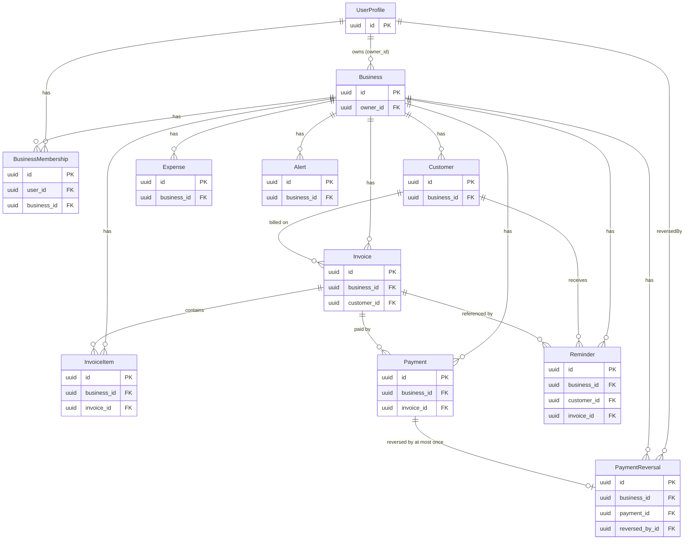

Entity-relationship diagram of the samonaFlow Prisma schema (`prisma/schema.prisma`), showing primary and foreign keys only.

Important relationships:

- Composite FK `Invoice(customer_id, business_id)` references `Customer(id, business_id)`.
- Composite FK `InvoiceItem(invoice_id, business_id)` references `Invoice(id, business_id)`; items cascade on invoice delete.
- Composite FK `Payment(invoice_id, business_id)` references `Invoice(id, business_id)`.
- Composite FK `Reminder(customer_id, business_id)` references `Customer(id, business_id)`.
- Composite FK `Reminder(invoice_id, customer_id, business_id)` references `Invoice(id, customer_id, business_id)`, so a reminder's customer must be the invoice's customer.
- Composite FK `PaymentReversal(payment_id, business_id)` references `Payment(id, business_id)`; `payment_id` is unique, so a payment is reversed at most once.
- `Alert.entity_id` (with `entity_type`) is a polymorphic reference to any entity. It has no foreign key.
